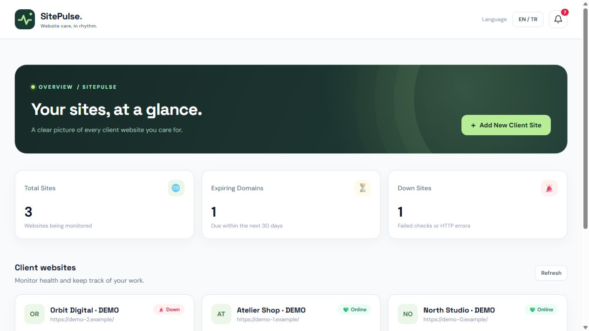
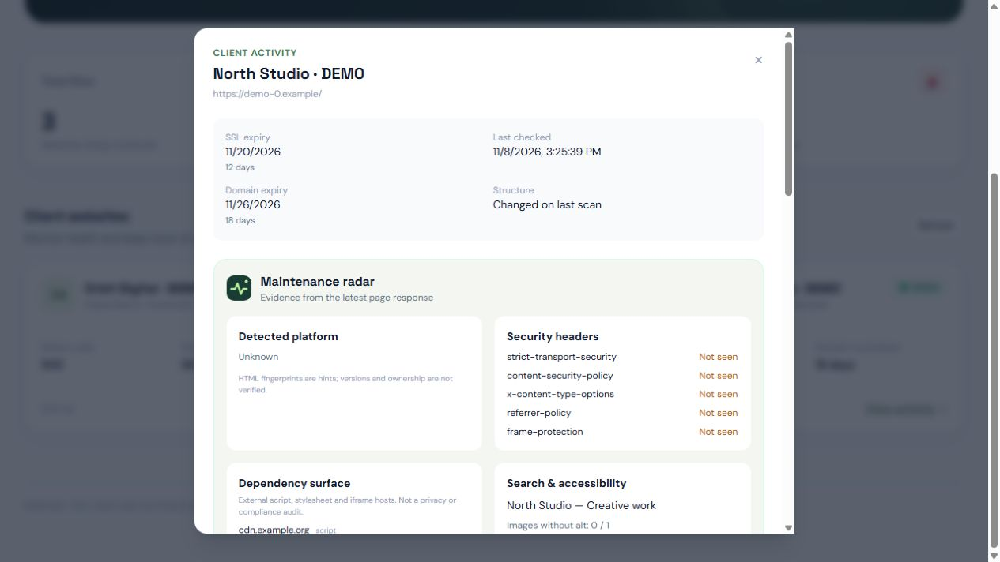
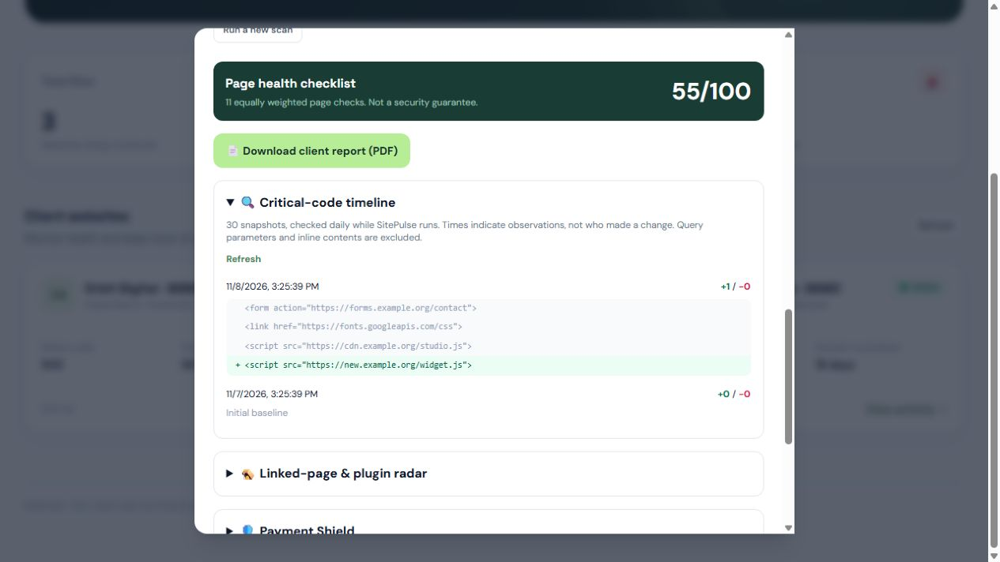
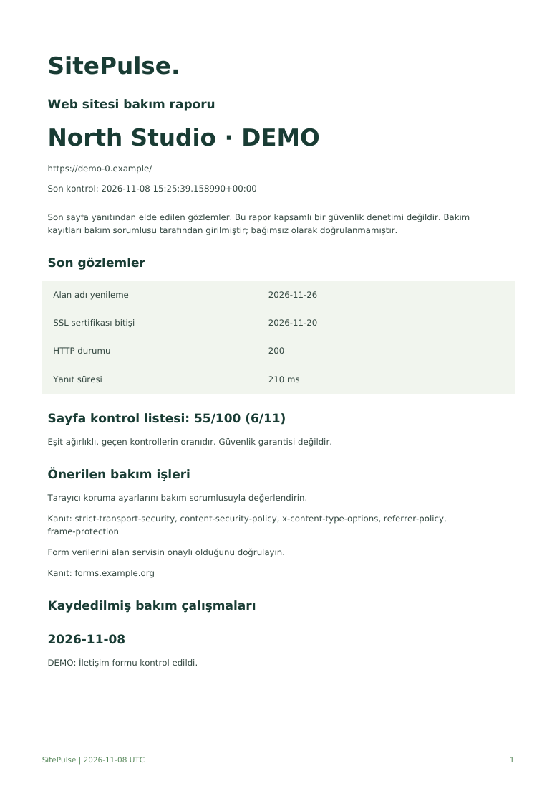

<p align="center"></p>
<h3 align="center">Website care, in rhythm.</h3>
<p align="center">Turn website signals into evidence, maintenance work, and clear client reports.</p>
<p align="center"><a href="README.tr.md">Türkçe</a> · <a href="https://github.com/anilcanolcer/sitepulse/releases/latest">Download Windows EXE</a> · <a href="#quick-start">Self-host with Docker</a></p>
<p align="center"><a href="https://github.com/anilcanolcer/sitepulse/actions/workflows/windows.yml"></a>   </p>

## A workspace for the person who maintains the website

SitePulse helps freelancers and small agencies answer three questions: **What changed? What needs attention? What work can I show the client?**

HTTP checks are the beginning. SitePulse connects renewal dates, page evidence, critical-resource changes, and your maintenance notes in one local workspace. Run it as a Windows app with SQLite, or self-host the FastAPI API and PostgreSQL stack with Docker.


*Actual application UI with clearly marked, synthetic DEMO clients. Screenshot dates and metrics are illustrative.*

## From signal to action

| Feature | What you get |
| --- | --- |
| 🌐 Client-site overview | HTTP status, response time, domain expiry, verified TLS certificate expiry, registrar, and maintenance history. |
| 🔍 Critical-code timeline | Red/green additions and removals of external scripts, stylesheets, iframe sources and form destinations. Last 30 snapshots; query values and inline contents excluded. |
| 🧭 Maintenance radar | Platform fingerprints with evidence, browser protection headers, insecure resources, form destinations, search metadata and basic image/language checks. |
| 🧩 Change receipt | New or removed external service hosts, disappeared headers and changed page titles between successful analyses. |
| 📄 Client-ready PDF | English or Turkish report combining the latest observations, suggested maintenance, and your recorded work. No AI key required. |
| 🪤 Linked-page radar | Explicit scan of up to five discovered pages on the same origin, respecting robots.txt. Sparse text is a review hint, not proof a page is abandoned. |
| 🔌 WordPress inventory | With the owner-installed receiver: active/inactive plugins, installed versions, and pending updates from WordPress's update cache. Public asset paths are shown separately as hints. |
| 🛡️ Payment Shield | Pair a signed WordPress receiver to request temporary public maintenance mode (HTTP 503) or restore the site. Requires explicit confirmation. |
| 💚 Site signals | In-app alerts for failed checks, approaching/expired domain and TLS dates, and structural change. Localized success messages. |



### Evidence you can review



A new third-party script is an observation to investigate. SitePulse does not claim to know who installed it, the exact installation time, or whether it is malicious. Timeline timestamps show when the scanner observed the page.

The page checklist uses **11 equal-weight checks**: title, description, language, image alt attributes, mixed resources, password-form transport, and five protection headers. Its score is passed checks / total checks, rounded to 100. It is not a vulnerability probability or a security certification.

### A report that earns trust



[Open the synthetic example PDF](docs/sample-report-tr.pdf). Reports distinguish observed findings from maintainer-entered work. They never invent a fix, a prevented hack, or a commercial result.

## Quick start

### Windows

1. Download **SitePulse.exe** from [Releases](https://github.com/anilcanolcer/sitepulse/releases/latest).
2. Open it, choose English or Turkish, and add a public website.
3. Review signals, run a new scan to compare changes, add maintenance notes, and download a client report.

Requires Windows WebView2. Data is stored at `%LOCALAPPDATA%\SitePulse\sitepulse.db`. Keep a backup of this file; it contains client data and any paired receiver secrets. The app exposes a random loopback API while open. Use on a trusted computer.

### Docker

Install and start Docker, then run from this repository:

```bash
docker compose up --build
```

Open [localhost:8000](http://localhost:8000). The older `docker-compose up --build` command also works with compatible Compose installations. PostgreSQL persists in the `postgres_data` volume. `docker compose down` stops it; `down -v` deletes its data.

The frontend uses Tailwind/Alpine/font CDNs and needs internet access. Scans need outbound DNS, HTTP(S), TLS and WHOIS. No external AI subscription is required.

| Setting | Default / purpose |
| --- | --- |
| PORT | 8000 on the host |
| BIND_ADDRESS | 127.0.0.1 |
| POSTGRES_PASSWORD | sitepulse; choose a strong value before first database startup |
| DATABASE_URL | Override the Python database connection when running outside Compose |
| CORS_ORIGINS | Comma-separated explicit origins when configured on the API service; same-origin needs none |

Changing the PostgreSQL environment password does not change credentials inside an existing database volume.

## Daily checks and scope

While the app/API is running, a scheduler checks for sites whose last check is more than 24 hours old, in batches of ten each minute. Desktop monitoring stops when you close the app. Run one API worker; multi-worker coordination is not implemented. Manual scans run immediately.

WHOIS data is registry-dependent and may be missing. TLS expiry requires a verifiable certificate. Page inspection does not execute JavaScript; dynamically rendered content may be absent. HTTP timing includes redirects and up to the first 1 MB of content. Structural MD5 is a bounded change hint, not a cryptographic security check. The linked-page scanner does not probe guessed backup files or submit forms. Plugin versions are **not matched to a vulnerability feed** and must not be interpreted as confirmed vulnerabilities.

## Pair a WordPress receiver

1. On a WordPress installation you are authorized to manage, copy `integrations/wordpress/sitepulse-shield.php` into `wp-content/mu-plugins/` (create the directory if needed).
2. Define a unique `SITEPULSE_SHIELD_SECRET` of at least 32 characters in `wp-config.php`. Generate it with `python -c "import secrets; print(secrets.token_urlsafe(32))"`. Do not commit it.
3. In the site's Payment Shield panel, pair `https://YOUR-SITE/wp-json/sitepulse/v1/shield` and that secret. The receiver hostname must match the monitored hostname.
4. Read authorized plugin inventory, or explicitly confirm a suspend/resume request. The receiver confirms state before SitePulse logs success.

The receiver verifies HMAC-SHA256 over the exact body, a five-minute timestamp window and event replay IDs. Public pages use an honest temporary-unavailability message and HTTP 503. Admins retain access. Exclude the receiver and maintenance responses from your CDN/page cache, test on staging first, and retain WordPress admin access to deactivate it. SitePulse does not process payments or decide whether an invoice is due.

## Development and verification

```bash
python -m pip install -r requirements-desktop.txt -r requirements-test.txt
python -m unittest discover -s tests -v
python desktop.py
python -m PyInstaller --noconfirm --clean sitepulse.spec
```

The EXE appears in `dist/`. GitHub Actions checks the PHP receiver protocol, starts PostgreSQL + API with Compose on Linux, runs Python tests on Windows, builds the EXE and checks packaged imports/database startup. Version tags publish the EXE to Releases. The startup check does not replace hands-on Windows/WebView testing.

The test suite covers persistence/cascade deletion, critical-resource diffs, query redaction, bounded/robots-aware crawling, PDF generation with Turkish text, signed webhook acknowledgement, HTTP validation, secret redaction and upgrade of older schemas. WordPress protocol tests use a small harness; a full WordPress/CDN deployment still needs staging validation.

## Deployment boundaries

This release is a trusted-local workspace, without login, account separation or user authorization. Add those controls before exposing it to untrusted users or turning it into a multi-tenant SaaS. Public-address validation is present, but DNS can change between validation and connection; isolate scan egress from internal services. Alerts are in-app, not OS push notifications. The AI payload helper is optional and does not send a request by itself.

## Contribute

Useful contributions include reproducible scanner cases, provider-specific WHOIS examples, accessibility reviews, translations and UI improvements. Open an issue with the expected behavior, observed behavior and a sanitized public example. Never post receiver secrets or private client data. If SitePulse helps your agency, a star helps other maintainers find it.

MIT licensed. Built for maintainers who prefer evidence over guesswork.
