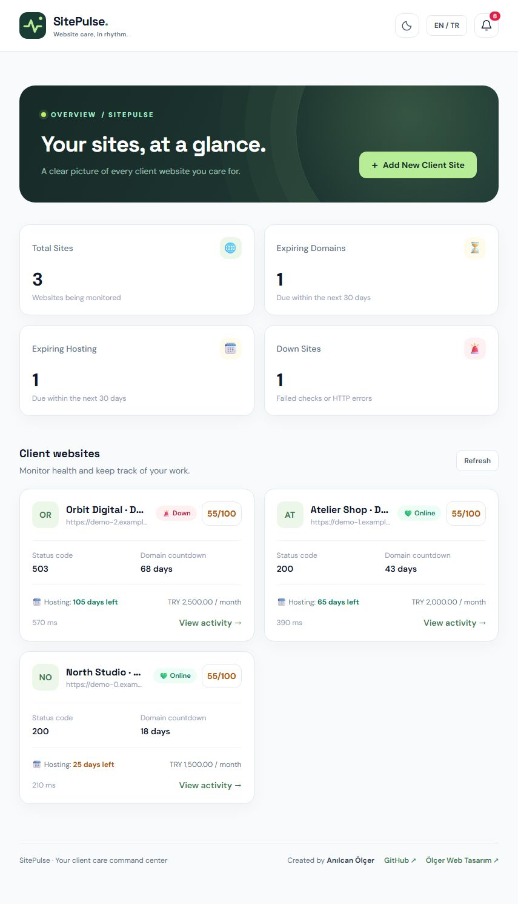
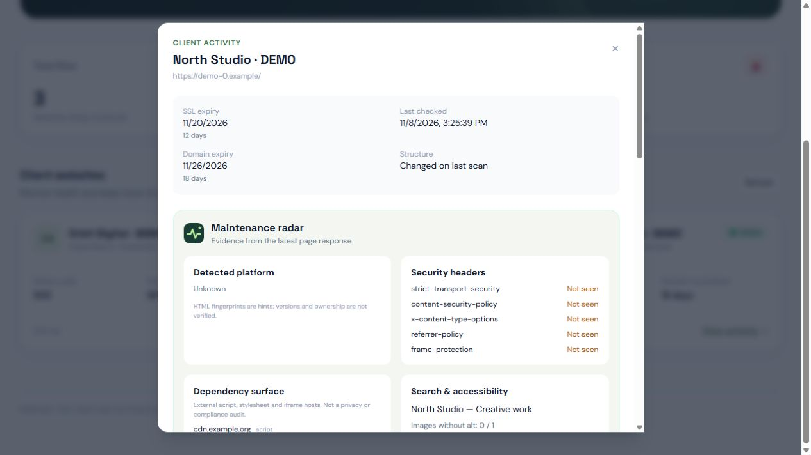
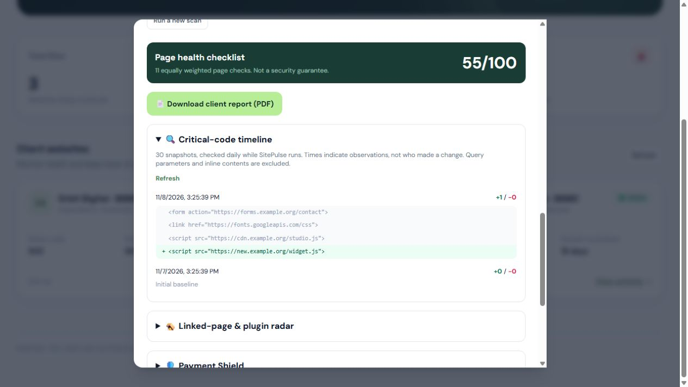
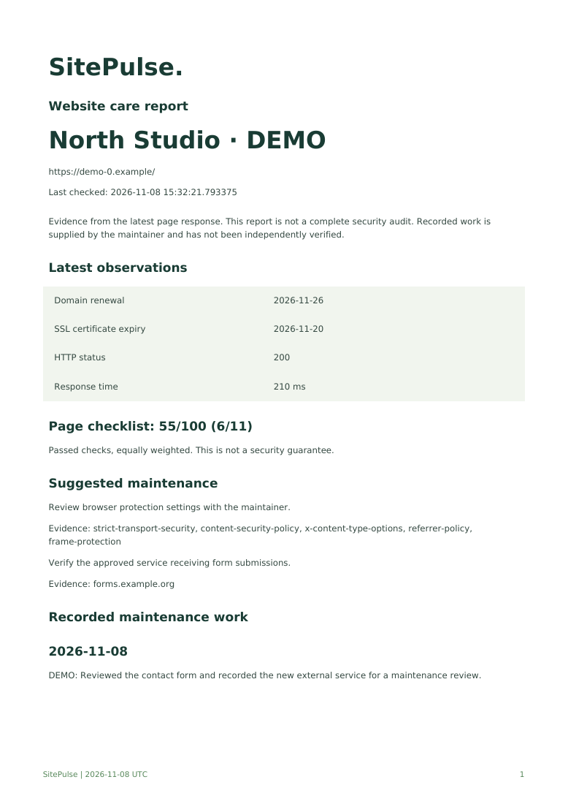

<p align="center"></p>
<h3 align="center">Sitelerinizin nabzını tutun.</h3>
<p align="center">Site sinyallerini kanıta, bakım işine ve anlaşılır müşteri raporuna dönüştürün.</p>
<p align="center"><a href="README.md">English</a> · <a href="https://github.com/anilcanolcer/sitepulse/releases/latest">Windows EXE indir</a> · <a href="#kurulum">Docker kurulumu</a></p>

## Ajans ve freelancer için bakım çalışma alanı

SitePulse üç soruya odaklanır: **Ne değişti? Neye bakmalıyım? Müşteriye hangi çalışmayı gösterebilirim?** Alan adı ve SSL yenilemelerini, sayfa kanıtlarını, kritik kaynak değişikliklerini ve bakım notlarını aynı yerde tutar. Windows sürümü yerel SQLite; Docker sürümü FastAPI ve PostgreSQL kullanır.


*Tüm tanıtım görselleri İngilizcedir. Uygulama Türkçeyi de destekler. DEMO olarak işaretlenmiş örnek müşteriler ve temsili ölçümler gösterilir.*

## Neler sunar?

| Özellik | Sağladığı bilgi |
| --- | --- |
| 🌐 Site özeti | HTTP durumu, yanıt süresi, alan adı/SSL bitişi, kayıt kuruluşu ve bakım geçmişi. |
| 🔍 Kritik kod zaman tüneli | Betik, stil, iframe ve form hedeflerinin eklenen/kaldırılan satırları. Son 30 kayıt; sorgu değerleri ve satır içi içerik saklanmaz. |
| 🧭 Bakım Radarı | Altyapı izleri, güvenlik başlıkları, güvensiz kaynaklar, form hedefleri, SEO ve temel erişilebilirlik kontrolleri. |
| 🧩 Değişim fişi | Yeni/kaldırılmış servis sunucuları, kaybolan güvenlik başlıkları ve değişen sayfa başlığı. |
| 📄 Müşteri PDF raporu | Son bulgular, önerilen bakım işleri ve sizin girdiğiniz bakım notları; Türkçe veya İngilizce. AI anahtarı gerekmez. |
| 🪤 Bağlantılı sayfa radarı | robots.txt kurallarına göre aynı adreste bulunan en fazla beş sayfa. Az metin, atıl sayfa kanıtı değil inceleme ipucudur. |
| 🔌 Yetkili WordPress envanteri | Kurulu alıcı ile etkin/pasif eklentiler, sürümler ve WordPress güncelleme önbelleğindeki bekleyen güncellemeler. |
| 🛡️ Tahsilat Kalkanı | Önceden eşleştirilmiş WordPress alıcısıyla genel sayfaları 503 bakım moduna alma/geri açma; işlem onayı gerekir. |
| 💚 Site sinyalleri | Erişim sorunu, yaklaşan/geçmiş alan adı ve SSL süresi, yapı değişikliği için uygulama içi uyarılar. |


*Detay ekranının İngilizce görünümü; aynı kontroller Türkçe arayüzde de bulunur.*



Yeni bir dış betik inceleme gerektiren bir gözlemdir. SitePulse kimin yüklediğini, kesin yükleme saatini veya zararlı olduğunu kendiliğinden bilemez. Zamanlar taramanın gözlem zamanıdır.

**Sağlık kontrol listesi** 11 eşit ağırlıklı kontrolden oluşur: başlık, açıklama, belge dili, görsel alt nitelikleri, karışık kaynaklar, parola formunun bağlantısı ve beş koruma başlığı. Puan, geçen kontrollerin toplam kontrollere oranıdır. Güvenlik garantisi veya saldırıya uğrama olasılığı değildir.

## Müşteriye gösterilebilir rapor



[Örnek PDF’yi açın](docs/sample-report-en.pdf). Gözlenen bulgular ile bakım sorumlusunun girdiği çalışmalar ayrıdır. Rapor yapılmamış bir düzeltmeyi, önlenmiş bir saldırıyı veya ticari sonucu uydurmaz.

## Kurulum

### Windows

1. [Releases](https://github.com/anilcanolcer/sitepulse/releases/latest) sayfasından SitePulse.exe indirin.
2. WebView2 bulunan Windows bilgisayarınızda açın; dil seçip ilk genel erişime açık sitenizi ekleyin.
3. Yeniden tarayın, değişiklikleri inceleyin, bakım notu ekleyin ve PDF raporu indirin.

Veriler `%LOCALAPPDATA%\SitePulse\sitepulse.db` dosyasındadır. Müşteri kayıtlarını ve varsa alıcı anahtarlarını içerdiğinden yedeklerini koruyun. Uygulama açıkken rastgele yerel bir portta API çalışır; güvenilir bilgisayarda kullanın.

### Docker

Docker’ı kurup başlattıktan sonra depo klasöründe:

```bash
docker compose up --build
```

[localhost:8000](http://localhost:8000) adresini açın. Uyumlu eski kurulumlarda `docker-compose up --build` kullanılabilir. Veriler `postgres_data` disk biriminde kalır. `docker compose down` durdurur; `down -v` verileri siler.

Varsayılanlar: `PORT=8000`, `BIND_ADDRESS=127.0.0.1`, `POSTGRES_PASSWORD=sitepulse`. İlk veritabanı kurulmadan güçlü parola seçin; sonradan ortam değişkenini değiştirmek mevcut veritabanı parolasını değiştirmez. Python bağlantısı `DATABASE_URL` ile değiştirilebilir. Ayrı frontend kullanıyorsanız API servisine `CORS_ORIGINS` tanımlayın. Aynı adresteki arayüz bunu gerektirmez.

Arayüz Tailwind/Alpine/yazı tipi CDN’leri için internet ister. Kontroller DNS, HTTP(S), TLS ve WHOIS erişimi kullanır. Harici AI aboneliği gerekmez.

## Günlük kontrol ve kapsam

Uygulama/API açıkken her dakika, son kontrolü 24 saati geçmiş en fazla 10 site taranır. Masaüstü uygulaması kapanınca izleme durur. Tek API worker kullanın; çoklu worker koordinasyonu yoktur. Elle tarama hemen başlar.

WHOIS bilgisi kayıt kuruluşuna göre eksik olabilir. SSL tarihi doğrulanabilen sertifikadan alınır. JavaScript çalıştırılmaz; dinamik içerik görünmeyebilir. Yanıt süresi yönlendirmeleri ve en fazla ilk 1 MB içeriği kapsar. MD5 yapı izi sınırlı bir değişim ipucudur. Tarayıcı tahmini yedek dosya isimlerini denemez, form göndermez. Eklenti sürümleri bir güvenlik açığı veritabanıyla eşleştirilmez; kesin açık tespiti olarak yorumlanamaz.

## WordPress alıcısını eşleştirme

1. Yönetme yetkiniz olan WordPress sitesinde `integrations/wordpress/sitepulse-shield.php` dosyasını `wp-content/mu-plugins/` içine kopyalayın.
2. `wp-config.php` içinde en az 32 karakterli benzersiz `SITEPULSE_SHIELD_SECRET` tanımlayın. Üretmek için: `python -c "import secrets; print(secrets.token_urlsafe(32))"`. Anahtarı Git’e eklemeyin.
3. Detay ekranında `https://SITENIZ/wp-json/sitepulse/v1/shield` ve anahtarla eşleştirin. Alıcı aynı izlenen sunucu adında ve HTTPS olmalıdır.
4. Yetkili eklenti envanterini okuyun veya askıya alma/geri açma işlemini açıkça onaylayın.

Alıcı HMAC-SHA256 imzasını, beş dakikalık zaman penceresini ve tekrar gönderim kimliğini kontrol eder. Genel sayfalara dürüst bir geçici erişilememe mesajı ve HTTP 503 döner. Yöneticiler erişebilir. Alıcıyı ve bakım yanıtlarını CDN/sayfa önbelleğinden hariç tutun, önce test sitesinde deneyin ve WordPress yönetim erişiminizi koruyun. SitePulse ödeme işlemez, faturanın gecikip gecikmediğine karar vermez.

## Geliştirme ve test

```bash
python -m pip install -r requirements-desktop.txt -r requirements-test.txt
python -m unittest discover -s tests -v
python desktop.py
python -m PyInstaller --noconfirm --clean sitepulse.spec
```

EXE `dist/` içine çıkar. GitHub Actions Linux’ta PHP alıcısını ve PostgreSQL/API Docker açılışını, Windows’ta Python testlerini, EXE derlemesini ve paketli başlangıç kontrolünü çalıştırır. Sürüm etiketleri EXE’yi Releases’e yayımlar. Başlangıç testi, Windows/WebView üzerinde elle kullanma testinin yerine geçmez.

Bu sürüm giriş sistemi veya hesap ayrımı olmayan güvenilir yerel çalışma alanıdır. Çok kullanıcılı SaaS’a veya güvenilmeyen ağa açmadan bu kontroller eklenmelidir. DNS doğrulama ile bağlantı arasında değişebilir; tarayıcı çıkış ağını iç servislerden ayırın. Bildirimler işletim sistemi push bildirimi değil uygulama içidir.

## Katkı

Tekrarlanabilir tarama örnekleri, WHOIS sağlayıcı örnekleri, erişilebilirlik incelemeleri ve çeviriler değerlidir. Issue açarken beklenen/gözlenen davranışı ve temizlenmiş örneği paylaşın. Anahtar veya özel müşteri verisi paylaşmayın. Ajansınızda işinize yarıyorsa bir yıldız, başka bakım sorumlularının projeyi bulmasını kolaylaştırır.

MIT lisanslıdır. Tahmin yerine kanıtla çalışan bakım ekipleri için.
